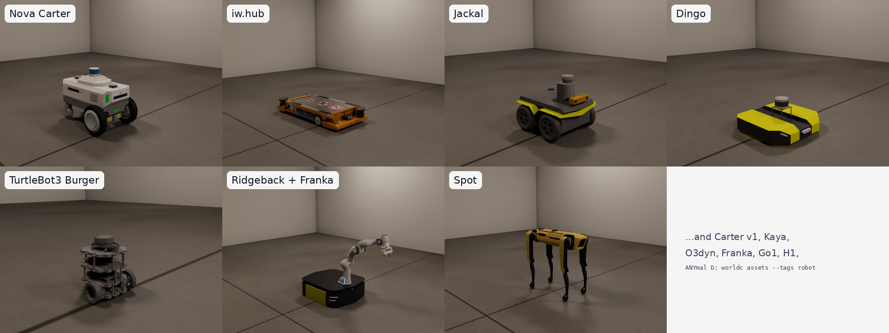
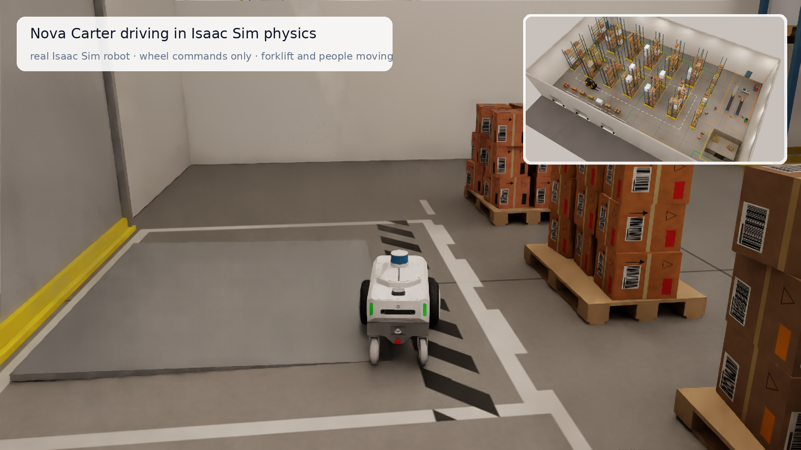

https://github.com/user-attachments/assets/b0a8029d-2aae-4e21-bd06-7f8de8fbe81f

<p align="center">
  
</p>

<h1 align="center">worldc</h1>

<p align="center"><b>A compiler for physical worlds.</b> Describe a place; get a simulation-ready environment you can verify.</p>

worldc lets an LLM agent build [Isaac Sim](https://developer.nvidia.com/isaac/sim) environments from a plain-language request,
and proves the result is correct. The agent writes a short declarative *scene spec*; worldc validates it, solves the layout,
builds the USD scene, checks geometry, navigation and physics, and renders it in Isaac Sim. When something is wrong, the agent gets a
precise, actionable error instead of a silent mistake, so it fixes the scene instead of guessing.

## Quickstart

**Requirements:** Python 3.12, [uv](https://docs.astral.sh/uv/), and **Isaac Sim 5.0 or newer** (`ISAACSIM_PATH`, default
`~/isaacsim`). Every command checks for Isaac Sim first and refuses to run without it.

```bash
uv sync --all-extras
uv run worldc isaac-check --deep

uv run worldc validate examples/specs/warehouse_lite.yaml
uv run worldc build examples/specs/warehouse_lite.yaml --seed 3 --out out/lite_3
uv run worldc check out/lite_3                       # the verification report again
uv run worldc render out/lite_3 --camera aisle       # fast preview render
uv run worldc drive out/lite_3 --video               # drive the robot to its goals in Isaac Sim, with chase and wide videos

uv run worldc recipe warehouse --seed 1 --out out/warehouse   # the 40 x 25 m fulfillment warehouse
```

More: `worldc assets --tags robot`, `worldc describe rack_row`, `worldc schema --section ObjectSpec`,
`worldc-import-mesh my_cart.glb --id cart_01 --mass 12`.

## Example worlds

Each of these builds in a few seconds (the warehouse in about 12) and passes the post-build checks. The specs are in
[examples/specs](examples/specs).

| spec | world | robot |
|---|---|---|
| [`minimal_room`](examples/specs/minimal_room.yaml) | 6 x 5 m store room: a work table against the north wall, cartons on it, a cone | Nova Carter |
| [`kitchen`](examples/specs/kitchen.yaml) | 4 x 3.5 m kitchen: L-shaped counter with drawers (one open), fridge, island, tableware, a window | TurtleBot3 Burger |
| [`industrial_deck`](examples/specs/industrial_deck.yaml) | 12 x 8 m pump room: pump set, instrument panel, cabinets, a gate valve, loose tools | Nova Carter |
| [`warehouse_lite`](examples/specs/warehouse_lite.yaml) | 20 x 14 m warehouse: two rack rows, a packing belt, a forklift loop, loose cartons | Nova Carter |
| [`outdoor_yard`](examples/specs/outdoor_yard.yaml) | 30 x 20 m outdoor yard: pallet stacks, concrete barriers, bins, a forklift loop | Nova Carter |
| recipe `warehouse` | 40 x 25 m fulfillment warehouse: six rack aisles, three dock bays, conveyors and a packing table, a charging area, a forklift and two people | Dingo (set any robot in the spec) |

## Real robots, real assets

Every robot is a real Isaac Sim asset with its own articulation, joints and sensors, referenced from NVIDIA's asset library and
never generated. Forklifts and people are NVIDIA's Isaac Sim forklift and characters, moving along waypoint paths. Everything else
comes from a registry of physics-ready procedural assets, your own meshes, and an offline index of 1,500 NVIDIA Omniverse assets.



```bash
uv run worldc assets --tags robot                  # every supported robot, with size and footprint
uv run worldc describe nova_carter                 # one robot: dimensions, ports, sensors
uv run worldc drive out/lite_3 --video             # drive it to its goals in Isaac Sim physics
```

Pick a robot in the spec with `robot: {asset: dingo}`.



## Documentation

- [docs/SPEC.md](docs/SPEC.md): the spec reference: relations, constraints, robots, outputs, every issue code
- [docs/ASSETS.md](docs/ASSETS.md): the asset contract and sources (procedural, mesh, user file, generated)
- [docs/CATALOG.md](docs/CATALOG.md): the Isaac Sim asset catalog: offline index, search, and the license notes for NVIDIA content
- [docs/MCP.md](docs/MCP.md): the MCP server and its tools
- [docs/DATAGEN.md](docs/DATAGEN.md): `worldc generate`: prompt to scene in one command, saved as a dataset
- [docs/OLLAMA.md](docs/OLLAMA.md): running `worldc generate` on Ollama models (local or cloud) instead of Anthropic

## What you get

From one request, with the same spec and seed always producing the same scene:

| output | what it is |
|---|---|
| `scene.usd` | the Isaac Sim scene: geometry, physics, articulations, lights, cameras |
| `scene_graph.json` | every object with its pose, size, mass, joints, goals and cameras |
| `resolved_spec.json` | the fully grounded spec: rebuilding it reproduces the scene exactly |
| `check.json` | the verification report (below) |
| `renders/` | Isaac Sim RTX images from every camera |
| `drive/` | optional: the robot driving to its goals in Isaac Sim, with chase and wide camera videos |

## Use it with an LLM agent

`worldc-mcp` is an [MCP](https://modelcontextprotocol.io) server, so any agent or client that supports MCP tools can drive it:

```json
{"mcpServers": {"worldc": {"command": "uv", "args": ["run", "--directory", "/path/to/worldc", "worldc-mcp"]}}}
```

| tool | purpose |
|---|---|
| `list_assets`, `search_assets`, `describe_asset` | find assets (registry first, then the Omniverse catalog) and read their parameters, anchors and physics |
| `get_spec_schema` | the spec format, whole or one section at a time |
| `list_recipes`, `get_recipe` | complete starting-point scenes (for example a warehouse) that the agent adapts instead of starting from nothing |
| `validate_spec` | schema and semantic checks plus a dry-run solve, with per-object placed counts |
| `build_scene` | solve and build the USD scene |
| `check_scene` | the verification report, including the Isaac Sim physics settle |
| `drive_robot` | drive the real robot to its goals in Isaac Sim physics and report whether it got there |
| `render` | fast proxy preview, or Isaac Sim RTX |
| `edit_scene` | apply a JSON Patch to a spec and re-validate |
| `import_asset`, `validate_generated_asset` | bring in your own mesh, or check a generated asset |

The agent loop is: search assets, write a spec, `validate_spec`, fix the issues it reports, `build_scene`, `check_scene`, look at
the renders, then `edit_scene` to refine. Details in [docs/MCP.md](docs/MCP.md).

## Generate from a prompt

`worldc generate` runs the whole agent loop for you, headless, with your own Claude Code login (no API key). The agent gets only
the worldc tools, builds and checks the scene, and the run is saved as a dataset record with a readable trace and Isaac Sim renders.

```bash
uv run worldc generate "A 12x8 m workshop with two work tables on the north wall and a pallet near the door"
uv run worldc generate --prompts-file prompts.txt      # one description per line
uv run worldc dataset list                             # also: stats, show <run_id>, export
```

Each run stops at a spend cap (`--max-budget-usd`, default 20), `--max-turns` or `--timeout`. Details in
[docs/DATAGEN.md](docs/DATAGEN.md).

## A spec, in one screen

```yaml
spec_version: "1.0"
name: minimal_room
environment:
  footprint: {type: rect, size: [6, 5]}
  height: 3.0
  walls: {openings: [{id: door, wall: south, center: 1.5, width: 1.15, height: 2.24, door: swing_door}]}
objects:
  - {id: table, asset: work_table, placement: {against: "wall:north"}}
  - {id: cartons, asset: cardboard_box, count: 2, placement: {on: table.top}}
  - {id: cone, asset: traffic_cone, placement: {near: {target: [-2.0, -1.0], radius: 0.5}}}
robot:
  asset: nova_carter                       # a real Isaac Sim robot
  spawn: {pose: {xy: [1.5, -1.0], yaw: 90}}
  nav_goals: [{id: at_table, type: inspect, target: table.front, approach: port}]
constraints:
  - {type: reachable, to: ["*"]}
```

## Development

```bash
uv run pytest            # about 510 tests
uv run pytest -m slow    # the longer end-to-end ones
```

Layout: `src/worldc/spec` (models, schema, validation), `solver` (layout), `assets` (registry, robots, catalog), `compile.py`
(USD build), `check` (post-build checks), `render` (proxy and RTX), `tools.py` and `mcp_server.py` (the agent tools),
`recipes` (parameterised starting points such as the warehouse), `examples/specs`.
